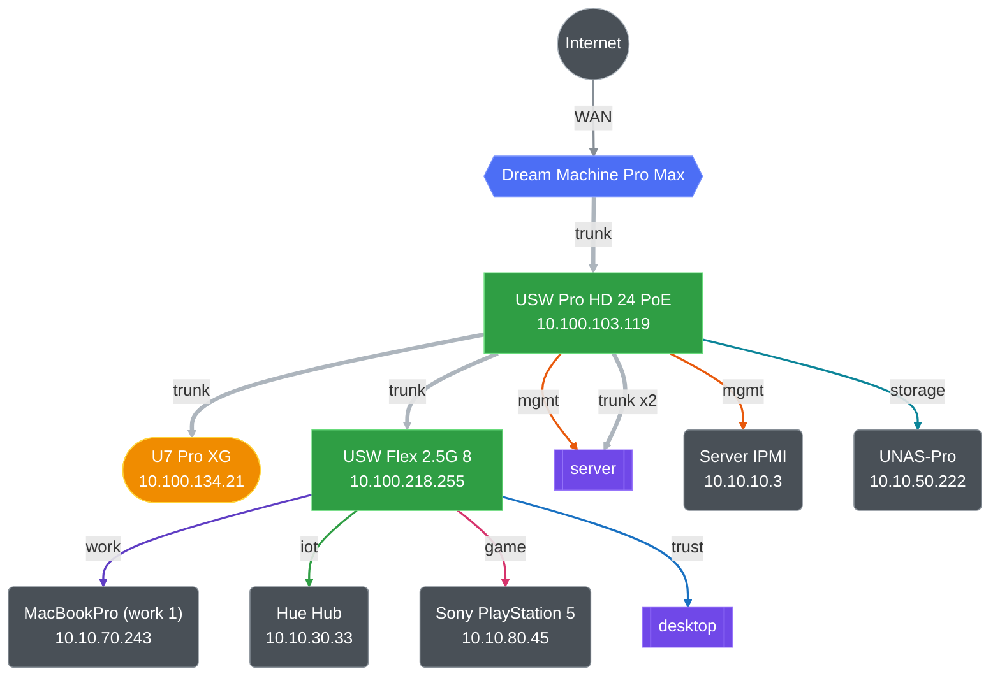

# NixOS Configuration

[](https://github.com/icebluerabbit/nixos/actions/workflows/ci.yml)
[](https://github.com/icebluerabbit/nixos/actions/workflows/promote.yml)
[](https://github.com/vic/den)
[](https://github.com/NixOS/nixfmt)

A highly modular NixOS configuration repository targeting desktop, server, and virtualized environments, built on a **dendritic aspect-oriented structure** of small, self-contained, shareable aspects using [den](https://github.com/vic/den).

It is also the single source of truth for the homelab's network. VLANs, static IPs, MAC bindings and port profiles are declared once in [`modules/infra`](modules/infra/README.md) and compiled two ways, which is what keeps the hosts and the physical switch and router in agreement:

- **NixOS** — host bridges, VLAN interfaces, firewall rules, internal DNS records.
- **Terranix → Terraform** — UniFi clients, networks, port profiles and device overrides; Cloudflare DNS.

## 🗺️ Network Topology

Both sections below are generated from `modules/infra` by `just topology`. Edit the aspects, not the markdown.

### Physical

<!-- BEGIN topology-physical -->

<!-- prettier-ignore-start -->

<!-- Generated by `just topology`. Do not edit. -->



<!-- prettier-ignore-end -->

<!-- END topology-physical -->

### VLANs and containers

<!-- BEGIN topology-logical -->

<!-- prettier-ignore-start -->

<!-- Generated by `just topology`. Do not edit. -->

| VLAN | id | subnet | host | containers | devices |
|:---|---:|:---|:---|---:|---:|
| media | 120 | 10.10.120.0/24 | 10.10.120.2 | 19 | — |
| services | 140 | 10.10.140.0/24 | 10.10.140.2 | 14 | — |
| apps | 110 | 10.10.110.0/24 | 10.10.110.2 | 9 | — |
| iot | 30 | 10.10.30.0/24 | 10.10.30.2 | 5 | 6 |
| download | 130 | 10.10.130.0/24 | 10.10.130.2 | 3 | — |
| dmz | 100 | 10.10.100.0/24 | 10.10.100.2 | — | — |
| game | 80 | 10.10.80.0/24 | 10.10.80.2 | — | 1 |
| guest | 40 | 10.10.40.0/24 | 10.10.40.2 | — | — |
| storage | 50 | 10.10.50.0/24 | 10.10.50.2 | — | 1 |
| trust | 20 | 10.10.20.0/24 | 10.10.20.2 | — | 4 |
| work | 70 | 10.10.70.0/24 | 10.10.70.2 | — | 2 |

#### media · VLAN 120 · 10.10.120.0/24

| container | address |
|:---|:---|
| autobrr | 10.10.120.14 |
| bazarr | 10.10.120.16 |
| beets | 10.10.120.18 |
| calibre-web | 10.10.120.17 |
| cleanuparr | 10.10.120.21 |
| cross-seed | 10.10.120.15 |
| flaresolverr | 10.10.120.13 |
| jellyfin | 10.10.120.10 |
| lazylibrarian | 10.10.120.3 |
| lidarr | 10.10.120.5 |
| mousetrap | 10.10.120.20 |
| prowlarr | 10.10.120.8 |
| radarr | 10.10.120.4 |
| readarr | 10.10.120.6 |
| seasonpackarr | 10.10.120.22 |
| sonarr | 10.10.120.7 |
| soularr | 10.10.120.19 |
| unpackerr | 10.10.120.11 |
| youtarr | 10.10.120.9 |

#### services · VLAN 140 · 10.10.140.0/24

| container | address |
|:---|:---|
| authelia | 10.10.140.13 |
| dnsmasq | 10.10.140.5 |
| grafana | 10.10.140.9 |
| hermes | 10.10.140.16 |
| lldap | 10.10.140.15 |
| loki | 10.10.140.8 |
| opencode | 10.10.140.7 |
| pgadmin | 10.10.140.4 |
| pi-hole | 10.10.140.6 |
| postgresql | 10.10.140.3 |
| prometheus | 10.10.140.10 |
| tempo | 10.10.140.12 |
| tuwunel | 10.10.140.14 |
| unifi-exporter | 10.10.140.11 |

#### apps · VLAN 110 · 10.10.110.0/24

| container | address |
|:---|:---|
| caddy | 10.10.110.4 |
| cinny | 10.10.110.9 |
| code-server | 10.10.110.3 |
| gitea | 10.10.110.7 |
| homepage | 10.10.110.5 |
| kiwix | 10.10.110.6 |
| openchamber | 10.10.110.8 |
| qui | 10.10.110.11 |
| thelounge | 10.10.110.10 |

#### iot · VLAN 30 · 10.10.30.0/24

| container | address |
|:---|:---|
| esphome | 10.10.30.5 |
| home-assistant | 10.10.30.3 |
| mosquitto | 10.10.30.7 |
| zigbee2mqtt | 10.10.30.8 |
| zwave | 10.10.30.6 |

#### download · VLAN 130 · 10.10.130.0/24

| container | address |
|:---|:---|
| qbittorrent | 10.10.130.5 |
| slskd | 10.10.130.6 |
| vpn-gw | 10.10.130.4 |

<!-- prettier-ignore-end -->

<!-- END topology-logical -->

## 📂 Repository Structure

The configuration is structured as independent modules, each containing distinct aspects that package system options, home-manager environments, and dependencies together:

| Module Category                                   | Description                                                                                                                         |
| :------------------------------------------------ | :---------------------------------------------------------------------------------------------------------------------------------- |
| 🖥️ **[apps](modules/apps/README.md)**             | GUI applications (Chromium, Neovide, kitty, etc.) and their user configurations.                                                    |
| 🥾 **[boot](modules/boot/README.md)**             | Disko disk layouts and impermanence roots. Bootloaders are per-host, in `modules/hosts/<host>/boot.nix`.                            |
| 🐚 **[cli](modules/cli/README.md)**               | Shell (Zsh), terminal tooling (Tmux, git, fzf), Neovim, and this repo's Claude Code and MCP configuration.                          |
| 📦 **[containers](modules/containers/README.md)** | systemd-nspawn container aspects (media stacks, databases, self-hosted applications), bridged directly onto VLANs.                  |
| 🛠️ **[dev](modules/dev/README.md)**               | Language servers, formatters and dev tooling (nixd, marksman, prettier, shfmt, tree-sitter).                                        |
| 🔤 **[fonts](modules/fonts/README.md)**           | System-wide custom font packages and rendering settings.                                                                            |
| 👥 **[groups](modules/groups/README.md)**         | User groups and shared access roles declarations.                                                                                   |
| 🖼️ **[gui](modules/gui/README.md)**               | Compositor configuration (Niri), bar modules (Quickshell), and notification daemons (Mako).                                         |
| 💻 **[hosts](modules/hosts/README.md)**           | Machine-specific host profiles (`desktop`, `server`) and hardware configurations.                                                   |
| 🔌 **[hw](modules/hw/README.md)**                 | Hardware-specific drivers (Nvidia, AMD), controllers (liquidctl, coolercontrol), and peripherals.                                   |
| 🌐 **[infra](modules/infra/README.md)**           | Network infrastructure definitions, static IP allocations, VLAN networks, device specifications, and cloudflare/unifi integrations. |
| 💿 **[iso](modules/iso/README.md)**               | Custom minimal installation ISO generation rules and automated setup scripts.                                                       |
| 📊 **[logging](modules/logging/)**                | Vector sidecar wiring that ships container and host journals to Loki.                                                               |
| 🔌 **[networking](modules/networking/README.md)** | Core system-wide network services (NAT, NetworkManager daemon configurations).                                                      |
| 🔒 **[security](modules/security/README.md)**     | Secret management setup utilizing SOPS-NIX and age keys.                                                                            |
| ⚙️ **[services](modules/services/README.md)**     | System daemons — SSH, resolved and DNS caching, logind, SDDM, Btrfs scrub/balance, udisks, notifications.                           |
| 🎨 **[style](modules/style/README.md)**           | Theme and system styling setup using Stylix (base16 templates).                                                                     |
| 👤 **[users](modules/users/README.md)**           | User account definitions and individual home-manager profiles.                                                                      |

Every directory under [`packages/`](packages/) is auto-`callPackage`d into `pkgs.homelab.<name>` and exposed as a flake output — a new package is just a new directory.

## 🔍 sys-mcp

[`packages/sys-mcp/`](packages/sys-mcp/) is an MCP server that answers questions about this repo: which host runs a container, what owns an IP or a port, which VLAN something is on, what is plugged into which switch port, and what the UniFi controller currently reports.

It also runs the diagnostics — journals, unit status, exec — and SSHes to the right host itself. That last part is the point: the same command on the wrong host returns wrong data with no error.

Declared in [`modules/cli/mcp.nix`](modules/cli/mcp.nix) and registered via home-manager's `programs.mcp`. The UniFi URL is resolved from the infra device definition; the API key is read from SOPS at runtime.

## 🛠️ Justfile Commands

### Building & Deploying

- **`just build`**: Builds both the server and desktop configurations (dry run).
- **`just build-desktop`**: Builds the desktop configuration locally without applying changes (dry run).
- **`just build-server`**: Builds the server configuration locally without applying changes (dry run).
- **`just test`**: Tests both the server and desktop configurations in-place temporarily.
- **`just test-desktop`**: Test desktop changes in place temporarily (reverts on reboot).
- **`just test-server`**: Test server changes in place temporarily (reverts on reboot).
- **`just switch`**: Apply the entire homelab configuration in sequence (runs network infrastructure apply, server deploy, and desktop apply).
- **`just switch-desktop`**: Apply changes immediately and switch the local desktop system.
- **`just switch-server`**: Deploy the NixOS configuration to the remote server host.
- **`just boot-desktop`**: Apply desktop changes and write them to the bootloader (active on next reboot).

### Infrastructure Orchestration

- **`just infra-plan-homelab`**: Preview declarative UniFi and Cloudflare configuration changes.
- **`just infra-apply-homelab`**: Deploy declarative UniFi and Cloudflare configuration changes.

### Documentation

- **`just topology [file]`**: Regenerates the Network Topology sections from `modules/infra`.
- **`just topology-watch [file]`**: Same, on every save.

### Secrets Management

- **`just sops-user-secrets`**: Edit user-level secrets (`secrets/user-secrets.yaml`) using SOPS.
- **`just sops-host-secrets`**: Edit host-level secrets (`secrets/host-secrets.yaml`) as root using the host's AGE key.

### Flake Maintenance

- **`just flake`**: Regenerates the `flake.nix` output mappings using `flake-file` to register new modules.
- **`just update`**: Performs a `nix flake update` to bump all input dependencies.
- **`just update-den`**: Updates specifically the `den` framework dependency.
- **`just format`**: Runs `nix fmt` (treefmt) over the repo — nixfmt, ruff, gofmt, shfmt and prettier, per `modules/formatter.nix`.

### VM Testing & Installer Development

- **`just vm-desktop`**: Launches the `desktop` configuration in a virtual machine for local testing.
- **`just vm-server`**: Launches the `server` configuration in a virtual machine.
- **`just make-iso [out]`**: Builds the custom installation ISO image (defaults output to `/tmp/nixos-installer`).
- **`just test-iso [out] [key]`**: Boots the generated installer ISO in QEMU to test partitioning and automated installs.

### System Cleanup

- **`just clean`**: Garbage collects the Nix store using root privileges.
- **`just gc`**: Runs `nh clean all` to prune old generations and optimize storage.

## 🚀 Getting Started

1. **Enter the environment**:
   If you have `direnv` enabled, entering the directory will automatically initialize the environment and install git hooks. Otherwise, run:
   ```console
   nix develop
   ```
2. **Apply changes**:
   Modify your settings, regenerate the flake configuration if you added new modules, and switch:
   ```console
   just flake
   just switch-desktop
   ```
