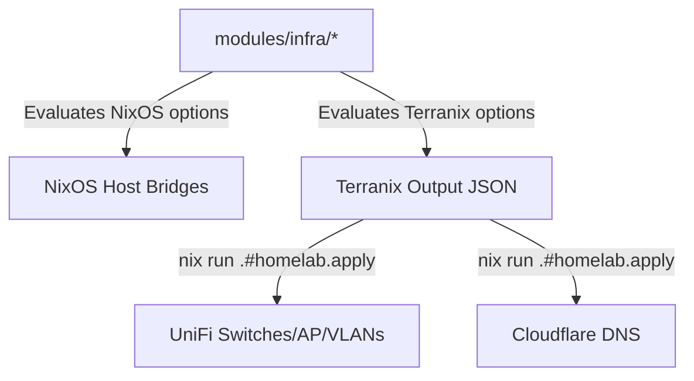

# 🌐 Infrastructure Modules (infra)

This directory manages the logical and physical hardware topology of the homelab. It serves as the data layer for both NixOS host interface setups and the UniFi/Cloudflare controllers.

## Architecture

We use a dual-engine design where infrastructure attributes are defined as modular aspects:
* **NixOS Profile**: The host queries these configurations to create local network devices (e.g. `br-media` bridged to `vlan-media` on `bond0.120`).
* **Terranix Profile**: Terranix compiles these aspects into a Terraform configuration to provision UniFi controllers and Cloudflare zones.



## Logical Network Map (VLANs)

The network is partitioned into distinct VLANs to enforce strict security boundaries, isolate chatty/untrusted devices, and manage traffic priorities:

| VLAN | Network Name | Subnet | Intended Use / Reason for Existence |
| :--- | :--- | :--- | :--- |
| **1** | Default | `10.100.0.0/16` | Untagged default LAN. Catch-all for new or unassigned hardware devices. |
| **10** | Management (`mgmt`) | `10.10.10.0/24` | Out-of-band management interfaces (UDM Pro Max, switches, APs, server IPMI/LOM). Isolates administration hardware from general client traffic. |
| **20** | Trusted (`trust`) | `10.10.20.0/24` | Highly trusted personal client devices (laptops, workstations, mobile phones). Has broad local access. |
| **30** | IoT (`iot`) | `10.10.30.0/24` | Smart home appliances, local hubs, and media streaming players. Isolated from trusted networks. |
| **40** | Guest (`guest`) | `10.10.40.0/24` | Network access for guests. Client isolation is enabled to prevent devices from communicating with one another. |
| **50** | Storage (`storage`) | `10.10.50.0/24` | Network-attached storage (UNAS, etc.). High-bandwidth and low-latency storage access. |
| **70** | Work (`work`) | `10.10.70.0/24` | Corporate/work-issued laptops and devices. Isolated to protect the personal LAN from corporate monitoring. |
| **80** | Game (`game`) | `10.10.80.0/24` | Gaming consoles (PS5, etc.) to isolate gaming telemetry and allow UPnP/port forward mappings safely. |
| **100**| DMZ (`dmz`) | `10.10.100.0/24` | Public-facing containerized services (reverse proxies like Caddy). Severely firewalled from internal networks. |
| **110**| Apps (`apps`) | `10.10.110.0/24` | General containerized utility applications. |
| **120**| Media (`media`) | `10.10.120.0/24` | Media indexing/management stack containers (Sonarr, Radarr, etc.). |
| **130**| Download (`download`) | `10.10.130.0/24` | P2P and downloading containers (qBittorrent, vpn-gw, cross-seed, etc.) to segment high-volume traffic. |
| **140**| Services (`services`) | `10.10.140.0/24` | Internal infrastructure helper containers (e.g. PostgreSQL, Redis) that support the application layers. |

## Directory Structure

* **`networks/`**: Logical network definitions (gateways, prefix subnets, and nameserver IPs).
* **`clients/`**: Static clients (MAC bindings, static IP mappings, and UniFi client configuration overrides).
* **`devices/`**: Physical infrastructure hardware (routers, switches, APs).
* **`cloudflare/`**: Cloudflare DNS zone settings.
* **`vpns/` & `wans/`**: Wide area networks and VPN mappings.

## Deploying Network Infrastructure

To preview and apply the infrastructure configuration (UniFi settings, DNS zones, clients), use the homelab Nix app runners:

* **Preview changes**:
  ```bash
  nix run .#homelab.plan
  ```
* **Apply changes**:
  ```bash
  nix run .#homelab.apply
  ```
